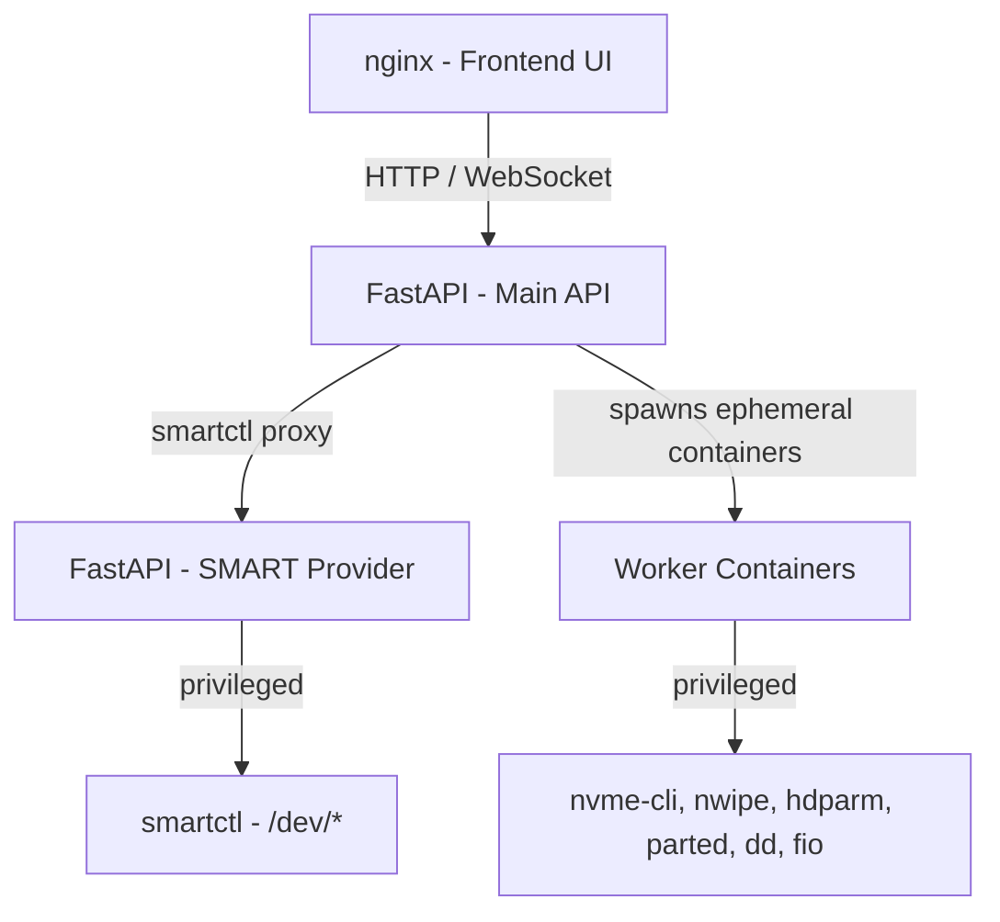

# Disk Hunter

> An all-in-one web utility for testing, managing, wiping, and formatting physical storage drives.

Disk Hunter provides a glassmorphic dashboard for administrative disk operations. A Python FastAPI backend orchestrates root-level commands inside ephemeral privileged Docker containers, keeping the host system isolated from destructive operations.

<p align="center">
  
  
  
  
  
</p>

## Features

- **Dashboard** — Drives, partitions, health and hardware in a unified grid with lightbox.
- **Secure Wiping** — `nwipe` (DoD, Gutmann, PRNG, zero), `hdparm` ATA Secure Erase, `nvme-cli` NVMe format (crypto + user-data) with PDF Certificate of Erasure.
- **ATA Frozen Drive Handling** — Multi-method unfreeze with NIST SP 800-88 Clear fallback.
- **S.M.A.R.T.** — Short/extended self-tests, live progress, parsed health table including NVMe/U.2/U.3.
- **Speed Tests** — `fio` read/write benchmarks with history.
- **Partition Editor** — Create, delete, format (ext3/ext4/fat32/ntfs) with batch operations.
- **ISO Downloader & Writer** — Download `.iso`/`.img` to `/app/data/isos`; every download and write is recorded in `iso_history.json`.
- **Temperature** — Multi-sensor page with server-side thresholds and selection.
- **Network Page** — `network.html`: view interfaces, gateway, DNS, validate a static or DHCP plan, render the netplan YAML. Apply (with optional 802.1Q VLAN) is disabled by default and only enabled with `NETWORK_APPLY_ENABLED=true`. Apply has an automatic rollback timer and never modifies the management interface.
- **Kiosk Mode** — Optional Firefox ESR kiosk on `tty2` (compose profile).
- **Onboard Help** — Modular Markdown guides with localized translations.
- **Glassmorphic UI** — Dark theme, custom modals, responsive layout, Potato Mode for low-end hardware.

## Architecture



| Component | Container | Role |
|-----------|-----------|------|
| Frontend | `disk-hunter-ui` | Vanilla HTML/CSS/JS served by nginx |
| Main API | `disk-hunter-api` | FastAPI orchestrator |
| SMART Provider | `disk-hunter-smart-provider` | Privileged FastAPI, `smartctl` proxy |
| Workers | `disk-hunter-*` | Ephemeral `nwipe`, `hdparm`, `nvme-cli`, `parted`, `smartctl`, `fio` |

All base images are digest-pinned and packages version-locked.

## Layout

```
.
├── backend/                FastAPI orchestrator
│   ├── api/                Routers (disks, shredding, history, partition, network, ...)
│   ├── docker-entrypoint.sh First-start: data dirs + JSON files, 755/644 perms
│   └── Dockerfile
├── html/                   Frontend served by nginx (bind-mounted, no rebuild)
│   ├── css/  js/           Styles and page logic
│   ├── components/         Header, footer, sidebar
│   ├── network.html        Network page (interfaces, gateway, DNS, netplan)
│   └── docs/               In-app help center Markdown
├── smart-provider/         SMART data microservice
├── workers/                Ephemeral task containers
│   ├── hdparm/ nvme/ nwipe/ parted/ smartctl-test/ speedtest-worker/ firefox-kiosk/
├── data/                   Runtime logs, PDFs, caches (gitignored)
├── docker-compose.yml
├── .env.example
└── nginx-entrypoint.sh     Generates nginx default.conf; must be mode 755
```

## Quick Start

Prerequisites: Linux host, Docker + Compose, physical drive access (`/dev`, `/sys`, `/run/udev` bind-mounted), root or sudo for Docker.

```bash
git clone <repo-url> Disk-Hunter
cd Disk-Hunter
cp .env.example .env       # edit if needed
docker compose up -d --build
# Optional kiosk (Firefox on tty2):
docker compose --profile kiosk up -d --build
```

UI: `http://localhost` (or the host IP on 80/443 if `HTTPS_CERT_PATH` / `HTTPS_KEY_PATH` are set).

## Configuration

All configuration is via `.env` (copy from `.env.example`).

| Variable | Description | Default |
|----------|-------------|---------|
| `ALLOWED_IPS` | Allowed client IPs, comma-separated, or `*` | `*` |
| `ENABLE_SHREDDER` | Disk shredding (nwipe, hdparm, nvme) | `true` |
| `ENABLE_SPEEDTEST` | fio benchmarks | `true` |
| `ENABLE_ISOWRITER` | ISO download and flashing | `true` |
| `ENABLE_SMARTCTL` | SMART self-tests | `true` |
| `ENABLE_DATA_MANAGEMENT` | File browsing, log management | `true` |
| `ENABLE_NETWORK_SHARE` | Network share module (frontend toggle) | `true` |
| `ENABLE_DELETE_HISTORY` | Allow log/history deletion; `false` makes audits append-only | `true` |
| `DATA_DIR` | Host path for logs, PDFs, metadata | `./data` |
| `FROZEN_FALLBACK_WIPE` | ATA Secure Erase: `1` = zero-overwrite on frozen, `0` = hard-fail | `1` |
| `KIOSK_URL` | URL the Firefox kiosk opens | `http://localhost` |
| `HTTPS_CERT_PATH` / `HTTPS_KEY_PATH` | TLS certificate and key paths (optional) | unset |
| `NETWORK_APPLY_ENABLED` | Allow the Network page to apply changes (`true`/`false`); when `false`, validate only | `false` |
| `DATA_UID` / `DATA_GID` | Optional numeric ids used by the backend entrypoint to `chown` the data directory on first start | unset |

### First-Start Permissions

`backend/docker-entrypoint.sh` creates the data folders and JSON files with `755` / `644` and never group or world writable. Permission failures are logged and do not abort the container. If `DATA_UID` / `DATA_GID` are set, the data directory is `chown`-ed to those ids.

### Server-Side Settings

Branding (company, address, phone, datacenter tags), temperature sensor selection, the Generate Cert (Certificate of Erasure) toggle, and the Generate Cert history are persisted in `data/branding.json` and `data/app_settings.json` on the Disk Hunter machine, shared across all clients.

## Kiosk Mode

For bare, air-gapped Linux hosts with no desktop environment, the optional `disk-hunter-firefox-kiosk` container launches a self-contained X server on the host's **tty2** and opens Firefox ESR in fullscreen kiosk mode at the Disk Hunter UI. Switch back with `Ctrl+Alt+F1`.

## Supply Chain Security

Base images are pinned by SHA256 digest; APK and pip packages are version-locked. Floating tags can be repointed upstream without notice — digest pinning prevents that. Lock variables are defined in `.env.example` and passed as build args to every Dockerfile.

## Recent Updates

- **2026-10-15** — VLAN (802.1Q) sub-interfaces added to the Network page (parent interface never modified; new `POST /api/network/vlan/remove` with gate and rollback). Validate paths verified on the dev machine; apply was not enabled.
- **2026-10-15** — Network page (interfaces, gateway, DNS, netplan validation) with `NETWORK_APPLY_ENABLED` gate and automatic rollback; backend entrypoint that creates data folders and JSON files with safe permissions; `iproute2` added to the API image; nginx entrypoint is now required to be mode 755 (otherwise `/api` and `/ws` silently 404).
- **2026-10-15** — Phase 1 fixes: NVMe/U.2/U.3 SMART parsing, unified serial lookup, drive card image replace (not overlap), NO TABLE badge, ISO `.iso` auto-append and download history, shredding selection survives mode switch, Confirm Data Destruction modal metadata persistence and bulk assignment, Generate Cert moved to `app_settings.json`, unified history columns and command-on-click, file browser opaque header, WebSocket/rAF and temperature visibility-pause perf. Validate paths and the API rebuild verified on the dev machine.
- **2026-09** — Multi-method ATA frozen drive unfreeze, NVMe secure erase with user-data fallback, security hardening (server-side drive validation, path traversal and command-injection guards, root-disk protection), multi-sensor temperature page, supply chain pin consolidation.

## TODO

- Active Directory / LDAP (SSSD, Kerberos) authentication for the portable boot environment: planned, not started
- Disk and partition cloning module (partclone / Clonezilla)
- Drive array / ZFS management module (zpool / zfs)
- Automated SMTP emailing of PDF erasure certificates
- Bulk firmware updates across uniform drive batches
- Network share / disk browsing module
- Default drive images for nvme / usb / ssd / hdd / sd
- Debian APT package pinning (backend, smart-provider, nwipe, firefox-kiosk)
- Authentication on API endpoints
- Retake all screenshots after the UI changes
